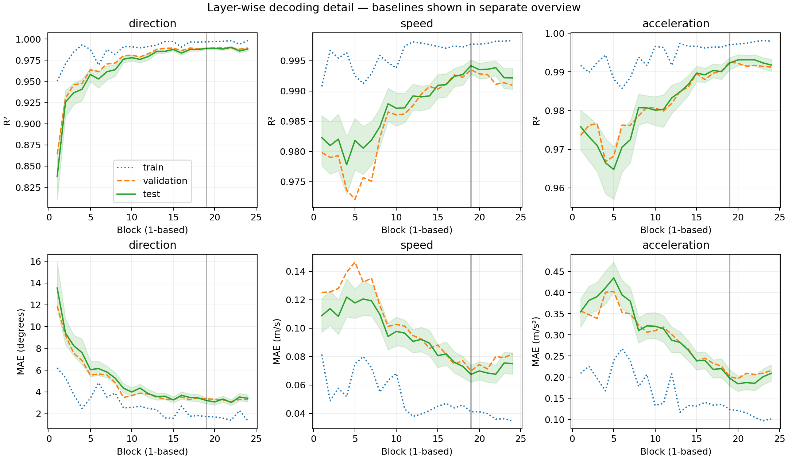

# Part 1, sections 1–4: results

> Follow-up audit: see [AUDIT.md](diagnostics/AUDIT.md). Independent calculations and fresh inference verified the core results; static and normalization controls support early direction decoding, but paper-matched reproduction remains incomplete.

Sections 5–6 (nullspace probing and steering) have not been run.

## Methods and verification

All 4,572 videos decoded as 16 RGB frames at 256×256 and 24 fps; video-file hashes were unique. The frozen encoder ran in float32 on one NVIDIA L40S GPU. Inputs retained all frames and the full native image; checkpoint channel normalization was applied. Default resize-to-292/center-crop was deliberately bypassed to preserve the scene. No temporal upsampling was used. Dynamic token indices and rotary position encoding support the observed 2,048 tokens. Hooks recorded post-block residuals before final encoder LayerNorm, averaged over space and time. Repeated inference agreed exactly, and the final hooked residual after LayerNorm agreed with the standard encoder output.

Linear ridge probes fit A; their regularization and intervention layers were chosen on B before any D scoring. C remains reserved for future independent steering evaluators. Features were centered using A only. Direction predicts sine/cosine, with angles recovered using atan2(sine, cosine); near-zero vectors are assigned zero degrees and counted. Scalar metrics use physical units. The ridge solver was checked against scikit-learn and angular wraparound against a 359°/1° example.

The split allocator rounded counts independently within each primary-label stratum. Consequently, realized proportions differ from the proposed 50/15/15/20 percentages; the exact frozen counts below are authoritative. Hash uniqueness ensures duplicate files do not cross partitions. These are new-clip, observed-label splits, not out-of-distribution tests.

| Dataset | A: fit | B: validation | C: reserved | D: test |
|---|---:|---:|---:|---:|
| direction | 768 | 220 | 220 | 292 |
| speed | 768 | 256 | 256 | 256 |
| acceleration | 768 | 256 | 256 | 256 |

## Validation-selected layers and held-out scores

Layers are **1-based**. Confidence intervals use 500 test-clip bootstrap resamples; they do not capture training-seed or model uncertainty.

| Variable | Layer | Test R² [95% CI] | Test MAE [95% CI] | Constant MAE | Shuffled-label MAE |
|---|---:|---|---|---:|---:|
| direction | 19 | 0.989 [0.988, 0.990] | 3.217° [2.920, 3.481] | 91.348 | 82.265 |
| speed | 19 | 0.994 [0.993, 0.995] | 0.068 m/s [0.062, 0.074] | 0.952 | 0.912 |
| acceleration | 19 | 0.992 [0.991, 0.994] | 0.198 m/s² [0.179, 0.218] | 2.476 | 2.335 |

The full baseline comparison is in `layerwise_probes.png` and `.pdf`. The detail plot separates the useful decoding range from strongly negative shuffled-direction R² values.

## Interpretation

All three quantities are decodable from the first block: test R² is 0.838 for direction, 0.982 for speed, and 0.976 for acceleration. Direction MAE improves from 13.53° at block 1 to 3.22° at the validation-selected block 19. Thus this simplified dataset supports early scalar decoding and improving direction decoding, but does **not** reproduce a sharp delayed direction-emergence zone. There is also no pronounced late-layer collapse. Possible contributors include dataset simplicity, pooled features, preprocessing, and the ridge fitting protocol; these explanations have not been isolated experimentally.

At block 19, temporal controls greatly worsen all three readouts. This supports sensitivity to temporal input structure, while leaving open shortcut explanations and distribution-shift effects. The validation set has 129 acceleration versus 91 velocity clips in the direction task, compared with nearly balanced final-test regimes; this modest split imbalance is documented in `split_balance.json`. A single shuffled-label fit also gives small positive scalar R² (roughly 0.1), so it should not be treated as a precisely estimated chance distribution.

## Temporal sensitivity checks

On a fixed subset of final-test clips (one per target label), apply the clean-trained, validation-selected probe to repeated-first-frame and deterministically reordered-frame inputs. These are sensitivity checks under distribution shift, not probes retrained on static data. They cannot alone exclude all static or displacement shortcuts.

| Variable | Input control | N | Clean MAE | Perturbed MAE |
|---|---|---:|---:|---:|
| direction | static | 64 | 3.516 | 89.300 |
| direction | shuffle | 64 | 3.516 | 77.216 |
| speed | static | 64 | 0.060 | 1.010 |
| speed | shuffle | 64 | 0.060 | 1.673 |
| acceleration | static | 64 | 0.209 | 3.085 |
| acceleration | shuffle | 64 | 0.209 | 5.653 |

## Limits and next-stage handoff

This is a single frozen split and checkpoint. A shuffled-label baseline uses one fixed shuffle; it is a sanity check rather than a permutation significance test. File hashes detect exact file duplicates, not every perceptually equivalent clip. Scalar-label correlations with starting x/y and sine/cosine direction are small, but marginal correlations do not rule out nonlinear confounds. The raw-angle correlation with sin(theta) in the audit is a circular-coordinate artifact, not evidence of nuisance leakage.

The layer-selection rule maximizes mean validation R² across tasks and uses that common layer only if all three validation R² values are at least 0.5; otherwise it uses task-specific validation-MAE minima. No nullspace or steering outcome has influenced the selection. All block-level fitted probes, test predictions, split IDs, validation selections, dependency versions, and provenance hashes are saved. Further model/hyperparameter changes after viewing these test results would require fresh evaluation discipline.

Primary artifacts: `probe_results.json`, `validation_selection.json`, `probe_protocol.json`, `splits.json`, `audit.json`, `model_smoke.json`, `run_provenance.json`, and `layerwise_probes.pdf`. Large feature shards remain under `/scratch/users/hmolin/jepa-interp/features/`.
