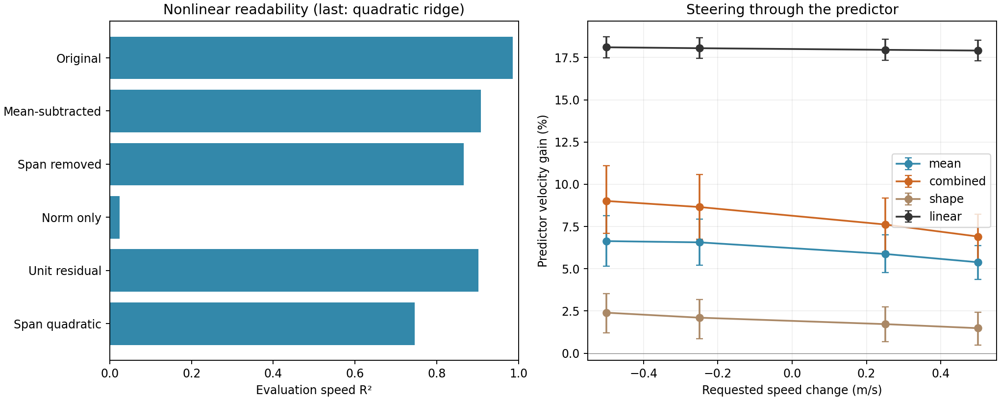

# Residual speed diagnostics and covariance steering

Nonlinear speed information survives label-independent removal of the mean curve’s span. A regularized covariance transport increases +0.50 m/s steering gain from 5.39% to 6.91%, but also increases edit size and position drift. At the same per-clip edit norm as mean-only steering, its gain is 5.46%. Frozen iterated linear steering remains stronger at 17.91%.

These experiments use the existing clips and GPU allocation 1887909. No clips were generated. A fits models; B selects diagnostic hyperparameters and the covariance model. D has been inspected in this research sequence, including while motivating the covariance experiment, so all conclusions are exploratory. No D predictor outcome tunes this model.

## What survives mean subtraction?

The first centroid subtraction removes linear readability, but a fixed projection removing the entire spline span also leaves nonlinear speed readability: D R² **0.866**. This projection removes 7 dimensions and uses no per-clip speed labels. Consequently, at least part of the nonlinear signal genuinely exists outside the mean curve’s span. This demonstrates decodability, not causal control.

RBF on residual magnitude alone is weak; normalizing every residual to unit length retains most nonlinear readability. Standardized pairwise products of PCA coordinates recover much more than coordinate squares alone. These results support feature interactions as an important source of the signal; they do not imply that a Gaussian covariance model captures all of it.

| Representation / probe input | Linear D R² | RBF D R² |
|---|---:|---:|
| original | 0.9853 | 0.9860 |
| true_speed_residual | -0.0125 | 0.9082 |
| estimated_speed_residual | 0.3237 | 0.9167 |
| curve_span_removed | 0.0449 | 0.8656 |
| residual_norm | 0.0061 | 0.0240 |
| residual_unit | 0.0230 | 0.9015 |
| span_removed_norm | -0.0016 | -0.0003 |
| span_removed_unit | 0.0175 | 0.8766 |

The estimated-speed subtraction uses the frozen C-trained speed ridge, so it needs no true label at inference. Its speed estimate is clipped to the spline support. The fixed span projection is the stronger check because it does not estimate speed either.

| Moment features | B-selected PCA dimension | D R² |
|---|---:|---:|
| Residual squares plus linear coordinates | 64 | 0.2958 |
| Residual quadratic plus linear coordinates | 64 | 0.7703 |
| Span-removed quadratic plus linear coordinates | 64 | 0.7464 |

## Can label-dependent subtraction create signal?

Yes. For three fixed random seeds, independently permute feature donors within A, B and D, destroying the original feature/assigned-speed pairing. Fit fresh probes before and after subtracting the curve evaluated at the assigned speed. The shuffled baseline is near chance, but the subtraction creates a predictable assigned-speed component. This is a demonstration of possible injection, not an estimate of what fraction of the real residual signal is injected. It explains why the earlier R²≈0.91 residual result alone was insufficient; the label-free span test above resolves that ambiguity in part.

| Shuffle seed index | Before subtraction RBF D R² | After subtraction RBF D R² |
|---:|---:|---:|
| 0 | -0.0094 | 0.8982 |
| 1 | -0.0114 | 0.8790 |
| 2 | -0.0000 | 0.8854 |

## Conditional covariance transport

Fit 64D PCA on A centroid residuals and standardize coordinates using A variances. Estimate speed-dependent second moments with Gaussian speed weights over A clips and shrink toward the global identity. These are moments around the original spline mean; remaining conditional mean error can contribute. B selects dimension from 8/16/32/64, bandwidth from 0.35/0.7/1.4 m/s and identity shrinkage from 0.25/0.5/0.75/1. Selection minimizes Gaussian negative log likelihood over the same 64 standardized dimensions, with the unmodified tail modeled as identity.

Selected: **64 dimensions, bandwidth 0.35 m/s, shrinkage 0.25**. B NLL is 26.011, versus 31.816 for identity. D NLL is 26.496, versus 32.043. Lower is better; common Gaussian constants are omitted.

For each clip, subtract the source mean, whiten the selected residual coordinates using the source covariance, color them using the target covariance, then add the target mean. Preserve the other coordinates. Map the pooled delta identically to all tokens and continue the original encoder/predictor. Zero change is identity; reversing source and target recovers the original representation to numerical precision. The shape-only condition applies only the residual transform. The random control rotates the complete edit using the previous fixed orthogonal matrix.

All downstream cases match the previous experiment: 184 D clips, ±0.25/±0.50 m/s in the original direction, frozen predictor and C-trained position readouts. Velocity gain is the free-intercept slope of position change versus future time, projected onto the physical requested velocity. It is not a fraction of encoded causal information.

| Requested Δspeed | Mean-only gain (%) | Mean + covariance gain (%) [95% CI] | Shape-only gain (%) | Linear gain (%) | Paired improvement over mean (percentage points) [95% CI] |
|---:|---:|---|---:|---:|---|
| -0.50 | 6.63 | 9.01 [7.09, 11.11] | 2.40 | 18.11 | 2.38 [1.18, 3.49] |
| -0.25 | 6.56 | 8.65 [6.76, 10.58] | 2.10 | 18.05 | 2.09 [0.87, 3.17] |
| +0.25 | 5.88 | 7.62 [5.99, 9.18] | 1.72 | 17.96 | 1.74 [0.68, 2.77] |
| +0.50 | 5.39 | 6.91 [5.44, 8.24] | 1.48 | 17.91 | 1.52 [0.51, 2.50] |

Representative +0.50 m/s condition:

| Method | Velocity gain (%) [95% CI] | Context drift (px) | Relative edit norm | Perpendicular slope (px/s) |
|---|---|---:|---:|---:|
| mean | 5.39 [4.38, 6.37] | 0.298 | 0.01120 | 0.620 |
| combined | 6.91 [5.44, 8.24] | 0.546 | 0.01482 | 0.889 |
| shape | 1.48 [0.50, 2.44] | 0.421 | 0.00946 | 0.795 |
| random | -1.97 [-2.69, -1.21] | 0.228 | 0.01482 | 0.668 |
| linear | 17.91 [17.30, 18.52] | 0.367 | 0.00726 | 0.411 |

## Equal edit-size follow-up

After observing that covariance edits were larger, fix a follow-up control that rescales each combined delta to the norm of its mean-only delta. The rescaled edit is a dose control and no longer promises exact transport to the target moments. No scale is chosen from predictor performance. This follow-up is exploratory, and its full protocol and predictions are in `norm_control/`.

| Δspeed | Mean-only gain (%) | Equal-norm covariance gain (%) [95% CI] | Paired gain above mean (percentage points) [95% CI] | Context drift (px) |
|---:|---:|---|---|---:|
| -0.50 | 6.63 | 7.68 [6.01, 9.39] | 1.04 [0.09, 1.89] | 0.447 |
| -0.25 | 6.56 | 7.30 [5.72, 8.94] | 0.73 [-0.17, 1.62] | 0.228 |
| +0.25 | 5.88 | 6.13 [4.86, 7.40] | 0.25 [-0.57, 1.07] | 0.217 |
| +0.50 | 5.39 | 5.46 [4.31, 6.54] | 0.08 [-0.68, 0.82] | 0.402 |

At +0.50 m/s, the equal-norm comparison shows no clear improvement, while position drift remains higher. Only the −0.50 m/s equal-norm paired interval excludes zero among these four conditions, with a small benefit. Thus covariance transport captures some useful structure but has not produced a substantial or consistent efficiency improvement over the mean edit. Iterated linear steering remains the stronger tested intervention.

Intervals use 1,000 clip bootstraps conditional on fitted models, without correction for multiple conditions. The complete B/D results, teacher-readout crosscheck, paired random and linear comparisons are in `effects.json`. The teacher readout’s previously poor transfer limits physical interpretation: these outcomes concern the frozen encoder–predictor–position-readout system, not generated videos.

## Does conditional whitening remove readability?

| Representation | Linear D R² | RBF D R² |
|---|---:|---:|
| raw_residual_coordinates | -0.0001 | 0.8082 |
| whitened_coordinates | -0.0106 | 0.1860 |
| whitened_full_residual | -0.0262 | 0.6756 |

Whitening uses the true source speed. This is a supervised diagnostic, not a label-free independence guarantee. Neither better likelihood nor reduced probe readability alone establishes better causal steering. This experiment tests one regularized covariance transport and one uniform token mapping; it cannot rule out other nonlinear steering methods.

## Validation and artifacts

Three unit tests verify noncommuting covariance transport, inverse/identity behavior, likelihood comparability across dimensions, positive definite shrinkage, and invariance of span projection to curve-span shifts. Runtime checks verify real-data round trips, exact zero-edit identity, pooled lift accuracy, and random norm matching. The A/B-selected settings are saved before D scoring. Protocols, predictions and source snapshots are retained.

